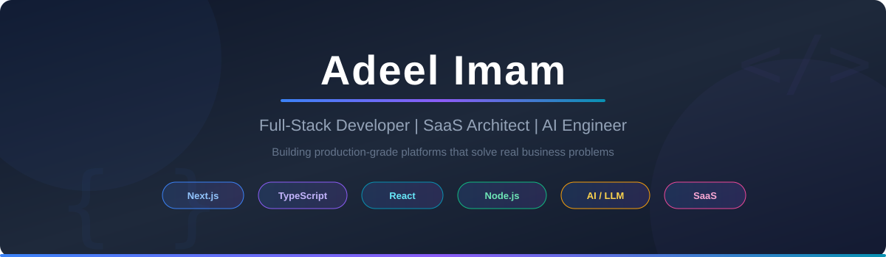

<div align="center">
  
</div>

<br/>

<div align="center">


</div>

---

<div align="center">

### Full-Stack Developer & SaaS Architect

Building **production-grade platforms** that solve real business problems.
From **AI-powered tools** to **compliance automation** — I ship complete products.

```javascript
const adeel = {
  title: "Full-Stack Developer & SaaS Builder",
  stack: ["Next.js", "TypeScript", "React", "Node.js", "Python", "Supabase"],
  currently: "Building AI-powered SaaS products",
  lookingFor: "Freelance projects & full-time opportunities",
  motto: "Ship fast, iterate faster, automate everything"
};
```

</div>

---

## What I Do

<table>
<tr>
<td align="center" width="33%">
<b>SaaS Products</b><br/><br/>
End-to-end SaaS platforms<br/>
Auth, payments, multi-tenant<br/>
analytics, billing, admin panels
</td>
<td align="center" width="33%">
<b>AI Integration</b><br/><br/>
AI-powered tools & automation<br/>
LLM integration, content generation<br/>
AI agents & workflow automation
</td>
<td align="center" width="33%">
<b>Full Stack</b><br/><br/>
Complete web applications<br/>
Frontend to database<br/>
DevOps, security, performance
</td>
</tr>
</table>

---

## Technology Stack

<div align="center">

**Frontend & UI**


**Backend & Database**


**DevOps & Cloud**


**AI & Automation**


</div>

---

## Featured Projects

<table>
<tr>
<td width="50%" valign="top">

### [A2P Master](https://a2pmaster.com)

**A2P 10DLC Compliance Website Generator**

Automated compliance website generation for SMS agencies worldwide.

- Multi-country support (US, AU, CA, GB, NZ)
- AI-powered content + blog system
- 44+ campaigns generated
- Payment integration (Whop)
- Admin dashboard + analytics

**Tech:** `Next.js` `TypeScript` `Supabase` `Tailwind CSS`

</td>
<td width="50%" valign="top">

### AI Drama Video Pipeline

**Professional AI Video Production System**

End-to-end AI video generation — from script to final render.

- Full pipeline: script to images to voice to video
- 30+ specialized AI skills
- Multi-character scene consistency
- Professional post-processing

**Tech:** `Python` `AI APIs` `FFmpeg` `ElevenLabs`

</td>
</tr>
<tr>
<td width="50%" valign="top">

### GHL Workflow Manager

**GoHighLevel Automation Platform**

Manage 840+ workflows across multiple locations.

- Multi-location management
- Workflow automation
- API integration with Firebase auth
- Real-time sync

**Tech:** `Node.js` `GHL API` `Firebase`

</td>
<td width="50%" valign="top">

### Browser Automation Suite

**Chrome DevTools Protocol Automation**

Remote browser control for AI agents without extensions.

- CDP-based automation
- WebSocket bridge for AI
- Screenshot + data extraction
- Headless + headed modes

**Tech:** `Node.js` `CDP` `WebSocket` `Playwright`

</td>
</tr>
</table>

---

## GitHub Analytics

<div align="center">


</div>

---

## GitHub Trophies

<div align="center">


</div>

---

## Professional Experience

| Company | Role | Duration |
|---------|------|----------|
| **A2P Master** | Founder & Lead Developer | 2026 - Present |
| **AI Video Systems** | Pipeline Architect | 2025 - Present |
| **Freelance** | Full-Stack Developer | 2019 - Present |

---

## Let's Connect

<div align="center">

[](https://a2pmaster.com)
[](mailto:adeelimam385@gmail.com)
[](https://github.com/adeelimam)

**Open to freelance projects and full-time opportunities!**

</div>

---

<div align="center">


From [adeelimam](https://github.com/adeelimam)

</div>
